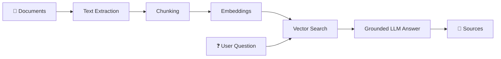
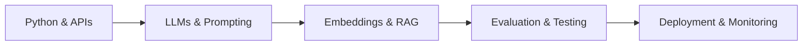

 

**From ideas to intelligent applications — thoughtfully engineered, continuously improved.**

 

---

## 

<table>
<tr>
<td width="56%" valign="top">

### Hello, I'm Huzaifa 👋

I'm a **BS Software Engineering student at Sir Syed University of Engineering & Technology (SSUET)** with a strong interest in **AI engineering, applied machine learning and full-stack development**.

My focus is on transforming AI concepts into useful applications: working with data, designing backends, integrating language models and building interfaces that people can actually use.

- 🧠 **Exploring:** LLMs, RAG, embeddings and intelligent workflows
- 🧩 **Building:** a document-grounded AI knowledge assistant
- ⚙️ **Engineering with:** Python, TypeScript, Java and databases
- 🎯 **Working toward:** an AI/ML engineering career
- 📍 **Based in:** Karachi, Pakistan

</td>
<td width="44%" valign="top">

### Developer profile

~~~python
class Huzaifa:
    education = "BS Software Engineering"
    university = "SSUET"
    location = "Karachi, Pakistan"

    interests = [
        "AI / ML Engineering",
        "LLMs and RAG",
        "Full-Stack Systems",
        "Developer Tools"
    ]

    motto = "Learn. Build. Iterate."
~~~

</td>
</tr>
</table>

---

## 

<table>
<tr>
<td width="50%" valign="top">

### 🤖 Applied AI & LLMs
Integrating language models into usable products, including structured responses, prompt design and retrieval-augmented question answering.

### 📚 Knowledge & Retrieval
Exploring document parsing, embeddings, vector search and source-grounded answers through a Python document Q&A project.

</td>
<td width="50%" valign="top">

### 🏗️ Software Architecture
Designing modular APIs, databases, authentication flows and testable application components.

### 🌐 Full-Stack Engineering
Building interfaces and backend workflows with technologies such as Next.js, React, TypeScript, Node.js and Python.

</td>
</tr>
</table>

> **My direction:** AI features are only useful when the surrounding software is reliable, understandable and easy to use.

---

## 

### Languages

### Web & Backend

### Databases & Tools

### AI Application Stack

Technologies I've worked with or am actively learning through projects; this is not a claim of expert proficiency in every tool.

---

## 

<table>
<tr>
<td colspan="2" align="center">

### 📄 AI Document Knowledge Assistant & Q&A App

A document-grounded question-answering application: extract content from PDFs, retrieve relevant passages and generate responses intended to carry source references. The repository contains planning, a retrieval baseline, a Python/Streamlit prototype and offline testing work.

**Engineering themes:** PDF ingestion · chunking · embeddings and retrieval · answer grounding · evaluation

</td>
</tr>
<tr>
<td width="50%" valign="top" align="center">

### 💬 ChatPilot AI

AI-powered customer-support SaaS concept focused on business-specific chat experiences, integrations and self-service workflows. The implementation is being reviewed for a more reliable architecture.

**Focus:** chat UI · authentication · persistence · AI integration

</td>
<td width="50%" valign="top" align="center">

### 🧳 Tourism Management System

A Java-based desktop management project exploring user workflows, bookings, data persistence and object-oriented design patterns.

**Focus:** desktop UI · Java design patterns · MongoDB

</td>
</tr>
</table>

---

## 

An illustrative retrieval-augmented generation workflow aligned with my document Q&A project, not a production-deployment claim.

---

## 

### 🐍 Contribution Journey

<picture>
  <source media="(prefers-color-scheme: dark)" srcset="https://raw.githubusercontent.com/huzaifasabeeh/huzaifasabeeh/output/github-contribution-grid-snake-dark.svg" />
  <source media="(prefers-color-scheme: light)" srcset="https://raw.githubusercontent.com/huzaifasabeeh/huzaifasabeeh/output/github-contribution-grid-snake.svg" />
  
</picture>

---

## 

| Track | What I'm focusing on |
|:--|:--|
| 🧠 **Applied AI** | LLM integration, prompt design and source-aware responses |
| 📚 **RAG systems** | Document pipelines, retrieval quality and vector databases |
| 🧪 **Software quality** | Automated tests, benchmarks and reproducible workflows |
| 🚀 **Delivery** | API design, deployment fundamentals and user-focused interfaces |

---

## 

### Have an idea involving AI, automation or full-stack software?

I'm interested in learning with other developers, discussing engineering ideas and collaborating on useful projects.

 

**BUILD • LEARN • ITERATE**

<!-- Third-party badge, graph and stat providers may cache responses or be temporarily unavailable. -->
